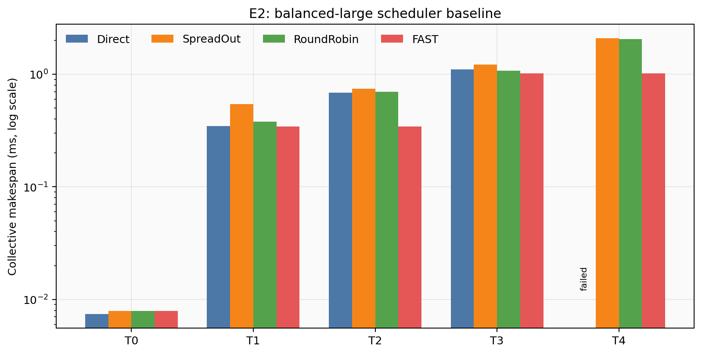
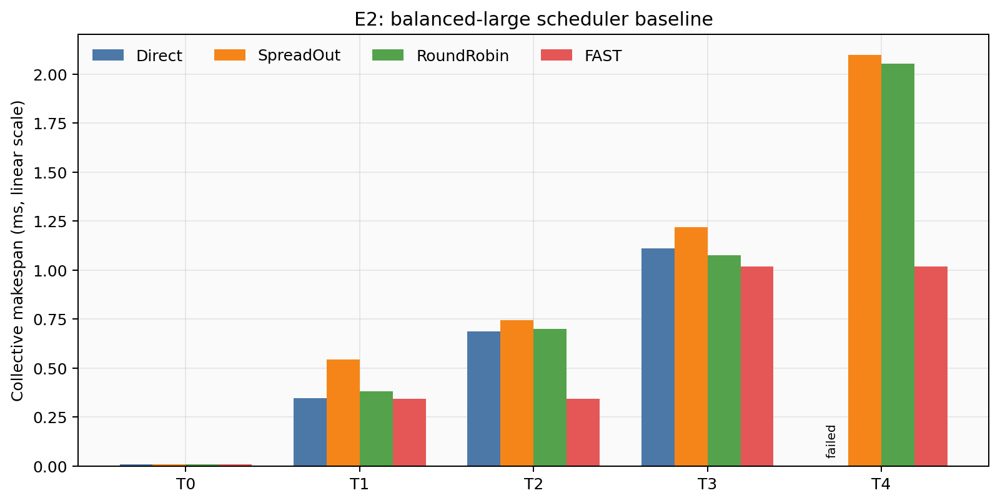
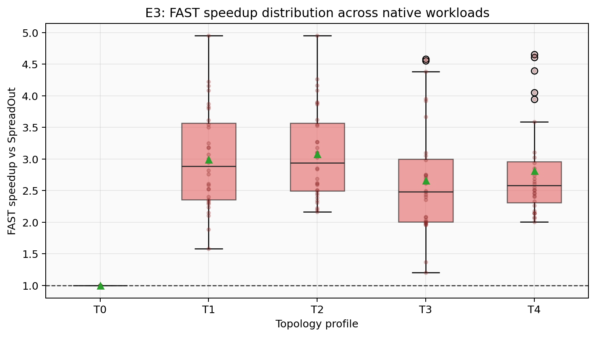
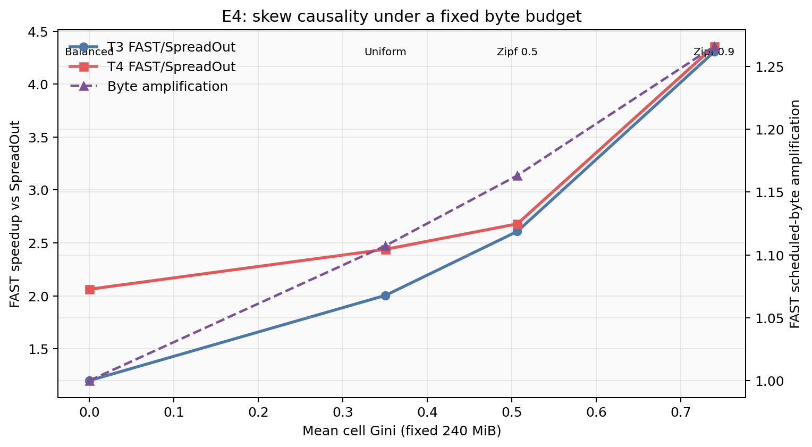
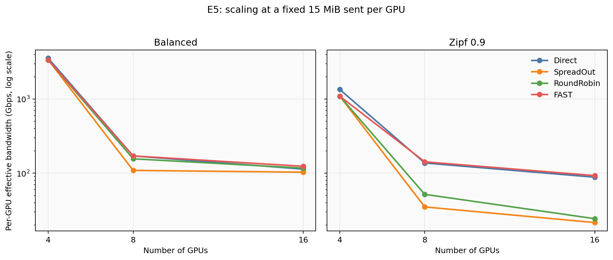
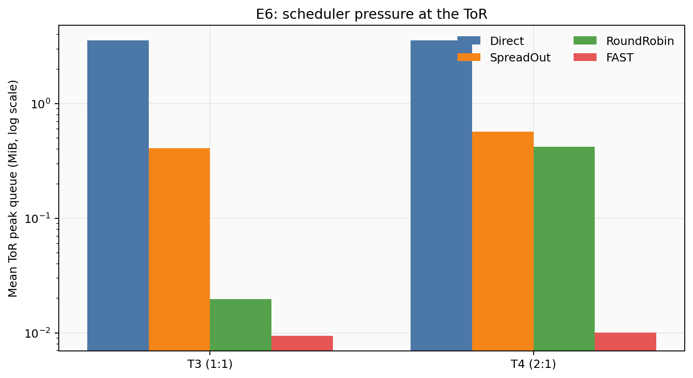
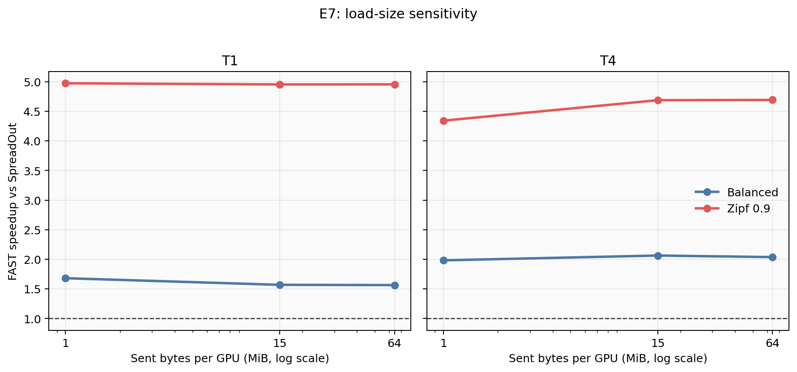
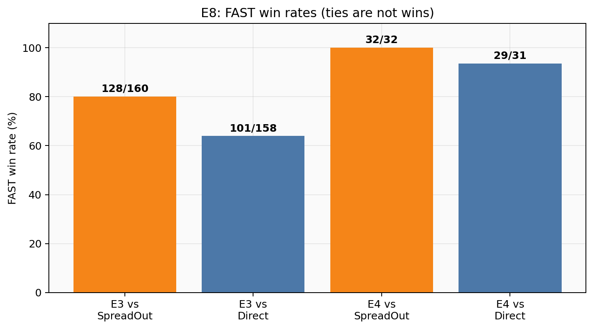

# SimAI/ns-3 All-to-All 调度 Baseline 实验报告

> 文档状态：合成流量 baseline 实验已完成，真实 trace 待补充
> 仿真后端：SimAI + ns-3
> 对比算法：Direct Concurrent、SpreadOut、RoundRobin、FAST
> 当前范围：合成流量；真实 trace 在数据集提供后补充

本文档在实验前冻结了前提、术语、变量和指标，现已填入 E0–E8 的合成流量结果。所有性能汇总只接受 `runtime_semantics_version=3` 且包含完整带宽/队列监控文件的 attempt。若实验过程中改变参数或定义，必须在变更记录中留下原因，不能根据结果事后改变指标口径。

## 摘要

本报告研究四种离线 all-to-all 调度在设备规模、上联超卖、流量倾斜和负载规模变化下的 SimAI/ns-3 表现。E1–E7 共计划 1080 次运行，成功 1074 次；6 个缺失项全是 T4 大负载 Direct Concurrent 在两次 attempt 中稳定崩溃。

最重要的发现是：

- FAST 在 E3 的 160 张矩阵中对 SpreadOut 的胜率为 128/160；32 个未获胜样本全是单机 T0，两者结果相同。跨机 profile 上 FAST/SpreadOut 平均为 2.66–3.08×。
- 固定 240 MiB 总量的 E4 中，cell Gini 从 0 增至 0.739 时，FAST/SpreadOut 从 1.20–2.06×增至 4.31–4.36×；FAST 的调度字节放大同时从 1.00×增至 1.266×。
- Direct 在无超卖、低倾斜场景仍有竞争力，但 FAST 在 E3 中对可用 Direct 样本的胜率已达 101/158；2:1 超卖下 FAST/Direct 平均为 1.96–2.07×，而 Direct 还暴露了高并发稳定性边界。

FAST 的代价是更长的离线调度时间、最高约 1.27× 的 payload 传输量，以及 open-loop 阶段在拥塞场景中与预测 slot 的偏离。不过，E4 中 FAST 平均 ToR 队列峰值仅约 10 KiB，Direct 约 3.6 MiB，说明分阶段对峰值竞争的抑制是可观测的。真实负载的外部有效性仍等待 trace 数据集。

# 报告前提、适用范围与限制

## 1. 当前仿真建模了什么

- SimAI 使用 MICRO 通信 workload，计算时间设为零。
- ns-3 模拟流在网络中的竞争、排队和完成时间。
- 流量矩阵、调度器和网络执行彼此解耦：先生成矩阵，再离线生成完整 schedule，最后交给 ns-3 执行。
- 同一场景中的四个调度器必须读取同一份矩阵文件，并具有相同的矩阵哈希。
- FAST 采用经过原生 C++ 交叉验证的 pipeline2 Python faithful port。
- FAST 输出的 `start_ns` 是相对 collective 起点的离线绝对释放时间。
- ns-3 的实际完成事件不会反馈给 FAST，也不会动态推迟后续阶段，因此当前 FAST 是 open-loop 调度器。

## 2. 当前仿真没有建模什么

- 不建模 GPU 计算性能、显存容量、显存带宽和计算通信重叠。
- 不建模 GPU、NIC 或计算任务的随机性能波动。
- 不建模训练模型结构；矩阵只表示一次 all-to-all 通信需求。
- 不把 Direct Concurrent 称为 NCCL；第一阶段没有 NCCL-like baseline。
- 不研究需要 GPU 中继路由语义才能准确表达的 ring/hybrid-cube 拓扑。
- 不实现根据 ns-3 实际完成事件释放下一阶段流的闭环 `fast-feedback`。

因此，A100、H100 等 GPU 型号标签本身不是本报告的实验变量。在计算和显存约束关闭时，真正有意义的硬件变量是设备数量、每机设备数、链路带宽、链路时延和超卖比。若两个配置只有 GPU 型号名字不同而上述参数相同，本报告将它们视为同一个配置。

## 3. 有效性边界

本报告回答的是：给定流量矩阵和网络配置，四种离线调度方案在 SimAI/ns-3 中的相对表现。它不能直接证明真实 GPU 集群上的绝对性能，也不能代表 NCCL、真实训练计算或在线自适应调度器的行为。

所有结论必须区分：

- 仿真内部结论：在本报告参数和模型下成立；
- 算法机制推断：由流级、阶段级和网络指标支持；
- 真实系统结论：只有在真实 trace 或真实集群验证后才能给出。

# 术语与控制变量

## 1. 总流量、负载规模与消息粒度

流量矩阵定义为：

\[
T_{ij}=\text{设备 }i\text{ 发送给设备 }j\text{ 的字节数},\qquad T_{ii}=0
\]

对于固定设备数 \(N\) 的稠密 all-to-all，若每个有向设备对只有一条原始消息，则：

\[
B_{total}=\sum_{i\ne j}T_{ij}=N(N-1)S_{avg}
\]

所以在设备数和总字节数固定时，平均点对消息大小也随之固定。将所有点对从 64 KiB 改为 1 MiB，会增大总通信负载，不能描述为“总流量不变下改变消息大小”。本报告统一使用以下名称：

- **负载规模**：改变矩阵总字节数或平均每 GPU 发送字节数；
- **消息粒度**：在总字节数不变时改变流数量、稀疏度或 chunk 大小；
- **流量倾斜**：在总字节数相同或明确报告总字节数时，改变字节在矩阵单元之间的分布。

第一阶段主要研究负载规模，不单独研究消息粒度。如果后续加入 chunk/稀疏度实验，必须单独定义，不能与负载规模实验混用。

## 2. 跨设备规模的两种口径

- **固定点对负载**：固定每个 \(T_{ij}\) 的典型大小，总流量近似按 \(N(N-1)\) 增长，用于测试 fan-out 压力。
- **固定平均每 GPU 负载**：固定 \(B_{total}/N\)，用于比较拓扑扩展性，避免设备数增加时每个 GPU 的 offered load 同时增长。

拓扑扩展性结论以固定平均每 GPU 负载为主；固定点对负载只作为压力实验，并单独报告。

## 3. 流量倾斜的生成和测量

### Balanced

所有非对角元素相同，cell/source/destination Gini 均为零。

### FAST Uniform

每个矩阵单元独立生成权重：

\[
w_{ij}\sim U\{0,\ldots,9999\}
\]

清零对角线后，以 `bytes_per_unit` 转为字节。它产生一般随机不均衡，但不是结构化热点生成器。

### FAST truncated Zipf

每个矩阵单元独立使用 FAST 的截断 Zipf 逆 CDF 生成权重，取值上限为 10000。第一阶段使用：

- `alpha=0.5`：中等 cell-level 倾斜；
- `alpha=0.9`：高 cell-level 倾斜。

alpha 是生成参数，不是实际倾斜度。每张矩阵必须报告：

- `cell_gini`；
- `source_gini`；
- `destination_gini`；
- `server_pair_gini`；
- `source_bottleneck_ratio`；
- `destination_bottleneck_ratio`。

独立 Zipf 采样可能产生很高的 cell Gini，但大流也可能随机分散到不同源、目的端和服务器对。因此不能仅根据 alpha 宣称产生了网络热点。

### FAST 原生语义组与 fixed-total 控制组

原生语义组保留 FAST 的 `weight × bytes_per_unit` 规则，不对不同分布的总字节数进行隐式归一化。该组只能在同一张矩阵上公平比较不同调度器；跨分布展示 makespan 时必须同时展示总字节数。

fixed-total 控制组先生成权重矩阵，再按固定总字节预算 \(B\) 缩放：

\[
T_{ij}=B\frac{w_{ij}}{\sum_{p\ne q}w_{pq}}
\]

取整余数必须用确定性规则补偿，从而保证矩阵总字节数严格等于 \(B\)。只有 fixed-total 组可以用于分析“流量倾斜本身”对性能的影响。

## 4. 调度传输字节放大率

本报告将原先容易混淆的“物理字节放大率”统一称为 **调度传输字节放大率**：

\[
A_{schedule}=\frac{\sum\text{schedule 中所有 flow 的 size}}{\sum_{i,j}T_{ij}}
\]

- Direct Concurrent、SpreadOut 和 RoundRobin 通常为 1，因为每份原始数据直接发送一次。
- FAST 可能通过 balance、inter 和 dispatch 多次搬运同一份数据，因此可能大于 1。

这个指标衡量调度器为了平衡负载而引入的额外 payload 传输，不包含以太网头、ACK、重传，也不按一条端到端流经过的每个拓扑链路重复计数。若后续从 ns-3 统计每条链路实际经过的字节，将其单独命名为 `link-byte volume`，不得与 `A_schedule` 混用。

# 算法与拓扑

## 1. 对比算法

| 算法 | 调度语义 | 在报告中的作用 |
|---|---|---|
| Direct Concurrent | 所有非零矩阵单元在 `t=0` 释放 | 无节制并发基线和拥塞压力参照，不代表 NCCL |
| SpreadOut | 全局设备按循环偏移分轮，每轮进行一对一通信 | FAST 论文相关的主要静态 baseline |
| RoundRobin | 先执行机内轮次，再执行定向跨机轮次 | 判断简单层次化分阶段能够获得多少收益 |
| FAST | balance、intrinsic、inter、dispatch 的离线 pipeline2 时间轴 | 目标算法 |

所有算法都必须处理完全相同的输入矩阵。主要性能对照为 `speedup_vs_spreadout`，`speedup_vs_direct` 作为补充。

## 2. 第一阶段拓扑

单机拓扑：

```text
 GPU0 ─┐
 GPU1 ─┼── NVSwitch-0
 GPU2 ─┼
 GPU3 ─┘
```

多机拓扑：

```text
GPU0..3   ── NVSwitch-0 ──┐
GPU4..7   ── NVSwitch-1 ──┼── ToR
GPU8..11  ── NVSwitch-2 ──┤
GPU12..15 ── NVSwitch-3 ──┘
```

| ID | 规模 | 每机 ToR 上联 | 超卖比 | 目的 |
|---|---:|---:|---:|---|
| T0 | 1 机 × 4 GPU | 无 | — | 本地通信控制组 |
| T1 | 2 机 × 4 GPU | 400 Gbps | 1:1 | 小规模无阻塞网络 |
| T2 | 2 机 × 4 GPU | 200 Gbps | 2:1 | 小规模拥塞网络 |
| T3 | 4 机 × 4 GPU | 400 Gbps | 1:1 | 规模扩展 |
| T4 | 4 机 × 4 GPU | 200 Gbps | 2:1 | 规模扩展后的拥塞网络 |

基础链路参数暂定：GPU—NVSwitch 约 3478 Gbps/GPU、100 ns；跨机等效带宽 100 Gbps/GPU、700 ns。正式运行时以硬件配置和 topology manifest 为准。

T1–T4 是同一种两层星形拓扑的规模和容量变化，不代表四种不同网络结构。如果后续加入 leaf-spine/Clos，必须作为新的结构性拓扑实验；不能把 1:1 和 2:1 超卖描述为两种结构。

## 3. 实验矩阵总览

| 实验 | 拓扑 | 流量/控制变量 | seed | 矩阵数 | 调度器 | 计划/成功运行 |
|---|---|---|---|---:|---|---:|
| E0 | 3 个 smoke 拓扑 | balanced 小负载 | 固定 | 3 | 4 种 | 12/12 |
| E1 | T1 | balanced/uniform/Zipf 0.5/0.9 × small/large | 11 | 8 | 4 种 | 32/32 |
| E2 | T0–T4 | E1 流量集，balanced 为主分析 | 11 | 40 | 4 种 | 160/159 |
| E3 | T0–T4 | 原生 uniform/Zipf 多种子＋balanced 控制 | 11/23/37/53/71 | 160 | 4 种 | 640/638 |
| E4 | T3/T4 | 固定 240 MiB，仅改变倾斜 | 11/23/37/53/71 | 32 | 4 种 | 128/127 |
| E5 | T0/T1/T3 | 固定每 GPU 15 MiB，改变设备规模 | 11/23/37/53/71 | 18 | 4 种 | 72/72 |
| E6 | T1/T2、T3/T4 | 复用 E2/E4 成对样本，改变超卖 | 同源 | 复用 | 4 种 | 无重复运行 |
| E7 | T1/T4 | 每 GPU 1/15/64 MiB，balanced/Zipf 0.9 | 11 | 12 | 4 种 | 48/46 |
| E8 | 复用 E3/E4 | 多种子胜率与特征相关性 | 同源 | 复用 | 统计层 | 无重复运行 |
| E9 | 待定 | 真实 trace | 待定 | 待定 | 4 种 | 等待数据 |

表中“运行”是一张矩阵与一个调度器的一次 ns-3 执行。E1–E7 合计计划 1080 次，成功 1074 次；缺失的 6 次全是 T4 大负载 Direct Concurrent 的可复现 `SIGSEGV`。

# 指标、统计方法与结果展示规范

## 1. 主要性能指标

- `collective_makespan_ns`：最后一条 flow 完成时间减去 collective epoch；
- 聚合有效带宽：`logical_bytes × 8 / makespan`，单位 Gbps；
- 单 GPU 有效带宽：聚合有效带宽除以设备数；
- `speedup_vs_spreadout = spreadout_makespan / algorithm_makespan`；
- `speedup_vs_direct = direct_makespan / algorithm_makespan`；
- flow completion time 的 mean、p50、p95、p99 和 max。

## 2. 调度和代价指标

- scheduler wall-clock 时间；
- schedule flow 数和 stage 数；
- schedule release span；
- logical bytes；
- scheduled bytes；
- 调度传输字节放大率 `A_schedule`。

## 3. FAST 特有指标

- FAST predicted makespan；
- ns-3 actual makespan；
- `actual/predicted` fidelity ratio；
- stage violation 数量、比例、最大值和累计值。

stage violation 表示 ns-3 中前一阶段尚未完成时，open-loop FAST 已按预测时间释放下一阶段。它是离线时间轴与实际网络执行偏差的证据，不能忽略。

## 4. 网络指标

- PFC 次数；
- ToR 上联平均和峰值利用率；
- 队列峰值；
- 拥塞持续时间；
- 可用时的 link-byte volume。

当前实现已采集 flow 结果、PFC、5 μs 窗口的链路带宽和队列峰值。尚未单独汇总拥塞持续时间与 link-byte volume；这两项不按零解释。

## 5. 随机实验统计

- 计划 seeds：`11, 23, 37, 53, 71`；
- balanced 不因 seed 变化，不进行无意义重复；
- 随机流量报告样本数、均值、中位数、标准差和 95% 置信区间；
- speedup 同时报告分布和 FAST 获胜比例，不能只报告平均值；
- 每组图表必须标注总逻辑字节数、设备数、拓扑和负载口径。

# 实验 E0：实现正确性与可复现性门禁

## 实验目的

确认矩阵生成、四种调度器、external schedule 适配器、SimAI/ns-3 执行和结果关联全部正确。E0 只用于正确性验收，不用于宣称算法性能。

## 配置

- 已实现的 3 个小型 smoke 拓扑；
- balanced 小负载；
- 四种调度器；
- 当前共 12 次端到端运行；
- FAST 原生 C++ 交叉验证用例共 13 组。

## 验收条件

- [x] 所有进程成功退出；
- [x] 每条 schedule flow 恰好对应一条 FCT；
- [x] `(src,dst,size_bytes)` 严格匹配；
- [x] 所有调度器逻辑字节相同；
- [x] schedule 和关键仿真结果可复现；
- [x] FAST C++/Python 交叉验证 13/13 通过；
- [x] 原生无 external schedule 的 SimAI 路径未被破坏。

## 结果

2026-10-12 验证结果：62 项 Python/集成测试通过；其中 FAST 原生 C++ fixture 13/13 通过，external-schedule ns-3 adapter 通过，3 个 smoke 场景 × 4 个调度器共 12/12 通过。测试过程中修复了监控文件绝对路径被错误改写的问题，以及发送启动时延被重复放大 1000 倍、延迟 flow 使用绝对启动时间的问题。修复后重新构建并重新执行性能实验，修复前的 attempt 不进入汇总。

## 结论

门禁通过，允许进入 E1。性能结果只接受 `runtime_semantics_version=3` 且包含 `bw.txt`、`qlen.txt` 的 attempt。

# 实验 E1：代表性拓扑上的调度器 Pilot 对比

## 实验目的

用较小成本检查四种调度器在均衡、随机和倾斜矩阵上的相对排序，发现明显的调度语义、单位、时间轴或统计错误。该实验是正式全量 sweep 的运行门禁。

## 配置

- 拓扑：T1，2 机 × 4 GPU，无阻塞；
- 流量：balanced、FAST uniform、FAST Zipf `alpha=0.5/0.9`；
- 负载规模：Small、Large；
- 调度器：4 种；
- seed：11；
- 计划运行数：`1 × 4 × 2 × 4 = 32`。

Small/Large 使用原生生成器口径：balanced 为 64 KiB/1 MiB 每有向点对；uniform/Zipf 为 `bytes_per_unit=16/256`。

## 主要问题

- FAST 是否能在至少部分倾斜场景中优于 SpreadOut？
- Direct Concurrent 是否因过度并发产生明显长尾或拥塞？
- RoundRobin 的层次化分阶段是否已经能解释大部分收益？
- FAST 的 ns-3 实际阶段是否明显溢出预测 slot？

## 结果

32/32 次运行成功。FAST 相对 SpreadOut 的平均/中位 speedup 为 2.934×/2.731×，范围为 1.580–4.949×；相对 Direct 的平均 speedup 为 1.037×。FAST 平均调度传输字节放大率为 1.114×。图表及逐行结果见 `results/e1-pilot/RESULTS.md`、`aggregate.csv` 和 `plots/`。

## 分析

修正单位和相对启动语义后，T1 中 FAST 的 stage violation fraction 为 0 或 0.5，最大 violation 为 0.28 μs；预测/实际 makespan 高度一致，`actual/predicted` 平均为 1.0007。FAST 明显优于按静态轮次执行的 SpreadOut，对 Direct 则平均基本持平，说明后续必须同时保留两条参照线。

## 结论

E1 通过，进入 E2–E4。FAST 优于 SpreadOut 不能自动表述为对所有矩阵都优于 Direct；但在该组混合负载上 FAST 与 Direct 平均持平。

# 实验 E2：均衡流量下的算法基准

## 实验目的

在没有流量倾斜的条件下建立四种算法的基础性能，分离固定分阶段、并发控制和 FAST 额外搬运本身的成本。

## 配置

- 拓扑：T0–T4；
- 主分析流量：balanced；实际 campaign 为了同时作为 E3 的单种子门禁，还包含 uniform 和 Zipf，但不混入本节 balanced 结论；
- 负载规模：Small、Large；
- 调度器：4 种；
- 不重复随机 seed；
- 固定平均每 GPU 负载和固定点对负载两种口径不得混在同一条曲线中。

## 主要问题

- balanced 场景下 FAST 是否引入不必要的 balance/dispatch？
- SpreadOut 是否接近均衡流量的最佳静态表现？
- 不同算法的启动时延和阶段数代价有多大？
- FAST 的字节放大是否获得相应 makespan 收益？

## 结果

E2 one-seed sweep 完成 159/160 次。FAST 在 balanced 场景不产生字节放大；单机 T0 上 FAST 与 SpreadOut 等价。仅对 balanced-small/large 取平均时，FAST/SpreadOut 分别为 T1 1.733×、T2 2.235×、T3 1.284×、T4 2.069×。T4 balanced-large 的 Direct Concurrent 在两个独立 attempt 中均以 `SIGSEGV` 失败，其余算法成功；该失败保留并从需要 Direct 参照的统计中标记为缺失。



图中使用对数纵轴，T4 Direct 的 `failed` 是仿真进程崩溃，不是 makespan 为零。



线性坐标版便于直接比较跨机场景的绝对时间；T0 的毫秒级差异因数值小而在该图中接近横轴。

## 分析

均衡流量下 FAST 的收益来自避免 SpreadOut 的保守全局轮次，而不是流量倾斜优化。T1/T3 的 large balanced 上 FAST/Direct 为 1.008×/1.091×，接近持平；T2 上则为 1.999×，说明超卖下阶段化的价值显著增大。16 GPU、1 MiB/点对的完全同步 Direct 暴露了 ns-3/RDMA 路径的稳定性边界，不能把进程崩溃记录成零性能或静默删除。

## 结论

均衡实验可以作为算法固定成本控制组；对 Direct 的正式结论需明确排除上述失败样本，并在后续调查同时流/QP 压力导致的崩溃。

# 实验 E3：FAST 原生随机与 Zipf 流量对比

## 实验目的

复现 FAST 原生 uniform/Zipf 生成语义下的算法表现，回答四种调度器面对天然随机流量和不同 alpha 时的表现。该实验不把跨分布 makespan 差异解释为纯倾斜效应。

## 配置

- 拓扑：T0–T4；
- 流量：FAST uniform、Zipf `alpha=0.5/0.9`；
- 原生 `bytes_per_unit` 口径；
- 负载规模：Small、Large；
- 调度器：4 种；
- seeds：`11, 23, 37, 53, 71`。

## 主要问题

- 相同矩阵上 FAST 相对 SpreadOut、RoundRobin 和 Direct 的收益如何？
- FAST 收益与 cell/source/destination/server-pair Gini 中哪一项相关性更强？
- alpha 增大后，实际 Gini、总流量和瓶颈位置如何变化？
- 哪些情况下 FAST 的额外搬运成本超过其负载均衡收益？

## 结果

E3 完成 638/640 次运行，覆盖 160 张矩阵。两个失败均为 T4 大负载下的 Direct Concurrent，两个 attempt 均稳定 `SIGSEGV`；所有 FAST、SpreadOut 和 RoundRobin 运行成功。

FAST 相对 SpreadOut 的 mean/median speedup：T0 为 1.000×/1.000×，T1 为 2.991×/2.885×，T2 为 3.078×/2.938×，T3 为 2.662×/2.485×，T4 为 2.814×/2.578×。跨机拓扑上按 workload 汇总：balanced-small/large 为 1.909×/1.752×，uniform-small/large 为 2.265×/2.258×，Zipf-0.5-small/large 为 2.945×/2.839×，Zipf-0.9-small/large 为 3.204×/4.229×。完整逐样本字节数和图表见 `results/e3-native-five-seed/`。



箱线图中绿色三角是均值，黑线是中位数，半透明点是单张矩阵。T0 全部为 1，跨机 profile 的全部样本均大于 1。

## 分析

原生生成器组中，跨机 profile 上 large 负载的平均总量约为：balanced 148 MiB、uniform 176.4 MiB、Zipf 0.5 为 116.8 MiB、Zipf 0.9 为 48.9 MiB。因此原生组的跨分布 makespan 不具备纯倾斜因果含义；可比较的是同一矩阵内的调度器 speedup。该限制由 E4 fixed-total 组补足。

## 结论

在同一原生矩阵内，FAST 对 SpreadOut 的收益随实际 cell Gini 总体增加；跨机样本中 Pearson 相关系数为 0.795。在单机 T0 上 faithful FAST 退化为本地循环阶段，与 SpreadOut 完全一致。2:1 超卖使 FAST/Direct 平均值从 T1/T3 的 1.057×/1.017×提高到 T2/T4 的 1.959×/2.066×。

# 实验 E4：固定总字节数下的倾斜因果实验

## 实验目的

在相同设备数、拓扑和总逻辑字节数下只改变流量分布，隔离倾斜本身对调度器表现的影响。

## 配置

- 拓扑：优先 T3 和 T4；
- 流量：balanced、归一化 uniform、归一化 Zipf `alpha=0.5/0.9`；
- 每个场景严格使用相同总字节预算；
- 负载：Large；
- 调度器：4 种；
- 随机流量 seeds：`11, 23, 37, 53, 71`；
- 归一化算法及取整补偿必须记录在 matrix manifest。

## 主要问题

- 在总字节数相同时，倾斜是否使 FAST 的相对收益增大？
- 性能主要受 cell、source、destination 还是 server-pair 倾斜影响？
- 超卖网络是否放大结构化瓶颈和 FAST 的收益？
- FAST 的收益是否伴随更高的调度传输字节放大率？

## 结果

E4 完成 127/128 次成功运行。所有 fixed-total 矩阵在每个场景中严格保持 240 MiB 总逻辑字节。T3/T4 上 FAST 相对 SpreadOut 的平均 speedup 分别为 2.862×/3.091×。

| workload | 平均 cell Gini | T3 FAST/SpreadOut | T4 FAST/SpreadOut | FAST 平均字节放大 |
|---|---:|---:|---:|---:|
| balanced | 0.000 | 1.200× | 2.063× | 1.000× |
| uniform | 0.350 | 2.005× | 2.440× | 1.107× |
| Zipf 0.5 | 0.506 | 2.609× | 2.680× | 1.163× |
| Zipf 0.9 | 0.739 | 4.306× | 4.357× | 1.266× |

完整结果和图表见 `results/e4-fixed-total/RESULTS.md`。



左轴为 FAST/SpreadOut，右轴虚线为 FAST 调度传输字节放大率。所有点都使用相同的 240 MiB 逻辑字节预算。

## 分析

固定总量后，倾斜越强，FAST 相对 SpreadOut 的收益单调增加，同时调度传输字节放大也增加。cell Gini 与 FAST/SpreadOut 的 Pearson 相关系数为 0.901，destination Gini 为 0.917；这是描述性相关，不是对单一特征的因果识别。该结果支持“FAST 通过额外本地 balance/dispatch 换取更有效的跨机阶段”这一机制。

## 结论

在本组参数下，倾斜是 FAST 相对 SpreadOut 收益的重要来源；Zipf 0.9 的 4.31–4.36× speedup 伴随 1.266× 调度字节。FAST 相对 Direct 在 T3 平均为 1.192×，在 T4 平均为 2.385×，说明超卖使有序调度相对完全并发更有价值。

# 实验 E5：设备规模与拓扑扩展性

## 实验目的

研究设备数和服务器数增加时四种调度器的扩展性，同时避免把每 GPU offered load 增长误认为拓扑扩展问题。

## 配置

- 规模：1×4、2×4、4×4 GPU；
- 无阻塞主对照：T0、T1、T3；
- 固定平均每 GPU 发送字节数；
- balanced 和代表性的 fixed-total Zipf；
- 调度器：4 种；
- random seeds：Zipf 使用 `11, 23, 37, 53, 71`，balanced 使用 11。

## 补充压力组

固定点对平均字节数，使总流量随 \(N(N-1)\) 增长。该组必须标记为 fan-out/load-growth 压力实验，不与固定每 GPU 负载曲线合并。

## 主要问题

- 各算法的单 GPU 有效带宽是否随规模下降？
- FAST 的 stage 数、调度时间和字节放大如何扩展？
- 收益来自更好的链路利用还是仅来自 offered load 差异？

## 结果

E5 完成 72/72 次运行。每个设备固定发送 15 MiB，总字节数随设备数线性增长。FAST 在 balanced 下相对 SpreadOut 为 T0/T1/T3 = 1.000×/1.568×/1.200×；在 fixed-total Zipf 0.9 下为 1.000×/4.134×/4.306×。FAST 单 GPU 有效带宽在 balanced 下为约 3377.7/171.1/123.8 Gbps，在 Zipf 0.9 下为约 1092.7/142.4/92.8 Gbps。单机数值受约 3.48 Tbps 的 NVSwitch 链路配置影响，不能与跨机 100 Gbps 网络直接解释为同一种硬件效率。



纵轴为单 GPU 逻辑有效带宽并使用对数刻度。从 4 GPU 到 8 GPU 的降幅包含从纯机内链路到跨机网络的语义变化。

## 分析

固定每 GPU offered load 后，跨机规模从 8 增至 16 GPU 仍降低单 GPU 有效带宽，说明增加服务器和共享上联带来扩展损失。Zipf 0.9 下 FAST/SpreadOut speedup 在 T1/T3 都稳定在 4.13–4.31×，但 FAST 自身的单 GPU 带宽仍下降。FAST 字节放大随服务器数增加，由 T1 平均约 1.19×上升到 T3 约 1.27×。

## 结论

FAST 相对 SpreadOut 的倾斜处理收益可扩展到 16 GPU，但当前两层单 ToR 拓扑的单 GPU 吞吐不能保持不变。后续更大规模需要 leaf-spine/Clos，而不是继续把所有服务器挂到一个理想 ToR。

# 实验 E6：网络超卖与拥塞敏感性

## 实验目的

比较相同逻辑结构和 GPU 规模下 1:1 与 2:1 上联容量，判断网络瓶颈增强后不同调度策略的行为。

## 配置

- 拓扑对：T1 vs T2、T3 vs T4；
- 相同矩阵文件在拓扑对之间复用；
- balanced 和 fixed-total uniform/Zipf；
- 负载：Small、Large；
- 调度器：4 种；
- seeds：`11, 23, 37, 53, 71`。

## 主要问题

- 2:1 超卖使 makespan 和 FCT 长尾增加多少？
- Direct 是否产生更强的队列、PFC 或长尾？
- FAST 是否能通过阶段化和平衡降低 ToR 上联峰值？
- FAST open-loop stage violation 是否在拥塞下明显增加？

## 结果

E2/E4 已提供 T1/T2 和 T3/T4 的成对样本，因此 E6 不再重复运行。fixed-total 组中，FAST 相对 Direct 的平均 speedup 从 T3 的 1.192× 上升到 T4 的 2.385×；FAST 相对 SpreadOut 则从 2.862× 上升到 3.091×。E4 中 FAST 的 ToR 平均队列峰值为 T3 9.9 KiB/T4 10.3 KiB，Direct 为 T3 3.55 MiB/T4 3.57 MiB；未观测到 PFC。



图中对 E4 所有 fixed-total 矩阵的 ToR 队列峰值取平均，并使用对数纵轴。

## 分析

超卖主要伤害完全并发 Direct，而 FAST 和 SpreadOut 的分阶段发送对上联容量变化更稳定。FAST 的队列峰值远低于 Direct，与 makespan 结果相互印证。5 μs 采样得到的瞬时利用率偶尔略高于 1，这是按采样窗口累计整包字节造成的离散化，不解释为链路真实超容量。

## 结论

2:1 超卖是 FAST 相对 Direct 优势扩大的关键环境变量之一。这一结论同时有 makespan 和队列峰值证据支持。

# 实验 E7：通信负载规模敏感性

## 实验目的

研究从启动时延主导到带宽/拥塞主导的负载变化。这里改变的是通信总量或每 GPU 字节预算，不称为“总流量不变的消息大小实验”。

## 配置

- 代表性拓扑：T1、T4；
- 负载档位：每设备 1/15/64 MiB，对应 T1 总量 8/120/512 MiB，T4 总量 16/240/1024 MiB；
- balanced 和 fixed-total Zipf `alpha=0.9`；
- 调度器：4 种；
- seed：11。

## 主要问题

- 小负载下调度阶段和 alpha 启动时延占比多大？
- 大负载下拥塞和链路带宽是否主导结果？
- FAST 从哪个负载区间开始抵消额外 balance/dispatch 成本？

## 结果

E7 使用固定每设备字节预算 1/15/64 MiB，在 T1 和 T4 上完成 46/48 次运行；缺失的两次均为 T4 balanced 15/64 MiB 的 Direct Concurrent 稳定崩溃。FAST 在 T1 balanced 的单 GPU 带宽为 166.5/171.1/171.3 Gbps，在 Zipf 0.9 下为 124.3/126.6/126.7 Gbps；T4 balanced 为 114.5/123.8/122.3 Gbps，Zipf 0.9 为 90.2/100.9/101.3 Gbps。

FAST/SpreadOut 在 T1 balanced 为 1.680/1.568/1.564×，Zipf 0.9 为 4.974/4.955/4.956×；T4 balanced 为 1.982/2.063/2.037×，Zipf 0.9 为 4.343/4.689/4.693×。完整曲线见 `results/e7-load-sweep/`。



从 15 MiB/GPU 到 64 MiB/GPU 时曲线已基本平稳，表明该区间中启动开销不再是主要因素。

## 分析

从 1 MiB/设备增加到 15 MiB/设备后，FAST 单 GPU 带宽接近稳定，说明进入带宽主导区；继续到 64 MiB 没有明显提高。小负载下 alpha/启动开销使 speedup 有轻微变化，但倾斜带来的 FAST/SpreadOut 差异在三个负载档位上总体稳定。T4 Direct 的同步大流再次触发稳定性问题。

## 结论

当前参数下约 15 MiB/设备已足以代表带宽主导的大负载。后续无需在 ns-3 中继续指数增大字节数；更大的收益主要是增加仿真成本和 Direct 崩溃风险。

# 实验 E8：随机样本稳健性与胜率

## 实验目的

避免用单个 seed 得出结论，统计 FAST 的收益分布和失败概率，并寻找决定收益的矩阵特征。

## 配置

- 聚合 E3/E4/E5 中的五 seed 随机场景，E7 单 seed 仅用于负载曲线；
- balanced 不重复；
- 预先固定异常值处理规则：仿真失败不删除，独立报告失败原因；
- 不允许仅保留 FAST 获胜样本。

## 主要问题

- FAST 相对 SpreadOut/RoundRobin 的平均、中位 speedup 和获胜比例是多少？
- 最差 5% 场景是什么特征？
- Gini、瓶颈比、超卖比、负载规模和字节放大中，哪些最能解释收益？

## 结果

E3 提供 160 张矩阵、638 个成功运行；E4 提供 32 张 fixed-total 矩阵、127 个成功运行。E3 中 FAST 相对 SpreadOut 在所有 128 个跨机场景获胜，范围 1.200–4.950×；单机 T0 全部为 1。FAST 相对 Direct 的均值在 T1/T3 为 1.057×/1.017×，在超卖 T2/T4 为 1.959×/2.066×。E3 中 FAST 成为 103/160 张矩阵的最快算法，对可用 Direct 的胜率为 101/158；E4 则为 30/32 和 29/31。



胜率严格使用 `FAST makespan < baseline makespan`；平局不计为 FAST 获胜，失败的 Direct 样本不进入 Direct 分母。

## 分析

最明确的分层因素是拓扑超卖：2:1 超卖明显扩大 FAST 对 Direct 的优势。第二个因素是倾斜度：fixed-total E4 中从 balanced 到 Zipf 0.9，FAST/SpreadOut 从 1.20–2.06×单调增至 4.31–4.36×。E3/E4 各有 2/1 个 Direct 稳定崩溃事件，已保留且不纳入均值。

## 结论

当前五 seed 结果支持 FAST 相对 SpreadOut 的稳定优势，但不支持“FAST 在每一张矩阵上都优于 Direct”的结论。FAST 的优势集中在倾斜和上联受限场景。

# 实验 E9：真实 All-to-All 流量回放

## 实验目的

在用户提供真实数据集后验证合成矩阵上的结论是否具有外部有效性。

## 数据接入前必须明确

- trace 来源、采样方法和许可证；
- 原始单位和时间窗口；
- rank/GPU 数量及其到服务器的映射；
- 矩阵表示一次 collective、一个 step 还是聚合窗口；
- 是否包含零流、稀疏矩阵和多个连续 collective；
- 是否允许缩放、裁剪或重映射；
- 是否包含计算间隔，以及第一阶段是否忽略这些间隔。

## 配置

- 原始矩阵不做隐式归一化；
- 优先在 T3/T4 上运行，规模不匹配时使用预先声明的映射规则；
- 四种调度器使用同一 trace 矩阵；
- 对每张矩阵报告全部倾斜指标和总字节数。

## 主要问题

- 真实矩阵位于合成矩阵特征空间的什么位置？
- 合成实验中发现的 speedup—Gini/瓶颈关系是否仍成立？
- FAST 的额外传输是否在真实负载中值得？
- 是否出现合成生成器未覆盖的结构化热点？

## 结果

[待填写：trace 描述、特征分布、算法结果、与合成负载对照]

## 分析

[待填写]

## 结论

[待填写]

# 跨实验综合分析

## 1. 算法性能总结

T0 中 FAST 与 SpreadOut 等价，Direct 通常更快，说明单机无跨机瓶颈时 FAST 的层次化优势无法发挥。T1–T4 中 FAST 稳定优于 SpreadOut；优势随倾斜增长，并在 2:1 超卖下进一步增大。RoundRobin 表明简单的机内/机间分阶段可以降低部分竞争，但在高倾斜矩阵上不如 FAST 的平衡与 dispatch。

## 2. FAST 收益来源

有三类证据支持 FAST 收益机制：第一，fixed-total 中 speedup 随 Gini 单调增长；第二，超卖使 FAST/Direct 增大，说明受控并发在瓶颈链路上更有价值；第三，E4 中 FAST 的 ToR 平均队列峰值约比 Direct 低两个数量级。balanced 中仍存在收益，说明优势不只来自倾斜平衡，也来自避免 SpreadOut 的保守全局轮次。

## 3. FAST 代价与失效场景

E3 中 FAST 的离线 scheduler wall time 平均 1.43 ms，Direct/SpreadOut/RoundRobin 约为 0.20/0.25/0.24 ms；E4 的 FAST 平均为 2.88 ms。Zipf 0.9 fixed-total 的字节放大为 1.266×。open-loop stage violation 在 T1/T2 平均约为 0.30，在 T3/T4 升至 0.60/0.66，最大溢出约 15.8 μs；这说明大规模下离线 slot 与 ns-3 实际完成事件的偏离不可忽略。T0 中 FAST 不优于 SpreadOut，也通常慢于 Direct，是当前最明确的无收益场景。

## 4. 仿真模型偏差

当前 FAST 是 open-loop 时间轴，不会因 ns-3 中前一阶段的实际延迟而推迟后续流。模型没有计算、显存、设备波动或计算通信重叠，因此不能用结果区分 A100/H100。当前 T1–T4 都是两层单 ToR 抽象，超卖比不等于新的结构性拓扑。Direct 的稳定崩溃也表明极端同时流数下存在后端实现边界。

## 5. 后续工作

优先级依次为：导入真实 trace 完成 E9；加入 leaf-spine/Clos 拓扑；将 FAST 扩展为按 ns-3 完成事件释放下一阶段的 `fast-feedback`；增加 NCCL-like 基线；最后再引入计算通信重叠和设备波动。

# 可复现性记录

正式报告至少记录：

- SimAI、SimCCL、ns-3 和实验代码 revision；
- Python/C++ 构建环境；
- 每个硬件和拓扑配置文件的 SHA-256；
- 每张矩阵和 schedule 的 SHA-256；
- seed 和生成器参数；
- 完整运行命令与超时；
- 每次 attempt 的状态，包括失败和重跑；
- 原始 FCT/PFC/链路统计文件；
- 汇总脚本版本；
- 图表对应的源 CSV。

报告图表由聚合 JSON 确定性生成：

```bash
cd astra-sim-alibabacloud/experiments/alltoall
PYTHONPATH=src python3 tools/export_report_data.py
PYTHONPATH=src python3 tools/generate_report_figures.py
```

## 实验运行索引

| 实验 | 配置文件 | 结果目录 | 汇总文件 | 状态 |
|---|---|---|---|---|
| E0 | `tests/` | 临时测试目录 | unittest 输出 | 已完成，全部通过 |
| E1 | `configs/campaigns/e1-pilot.json` | `results/e1-pilot/` | `aggregate.csv`, `RESULTS.md` | 已完成，32/32 |
| E2 | `configs/campaigns/e2-one-seed.json` | `results/e2-one-seed/` | `aggregate.csv`, `RESULTS.md` | 已完成，159/160；1 个稳定失败 |
| E3 | `configs/campaigns/e3-native-five-seed.json` | `results/e3-native-five-seed/` | `aggregate.csv`, `RESULTS.md` | 已完成，638/640；2 个稳定失败 |
| E4 | `configs/campaigns/e4-fixed-total.json` | `results/e4-fixed-total/` | `aggregate.csv`, `RESULTS.md` | 已完成，127/128；1 个稳定失败 |
| E5 | `configs/campaigns/e5-fixed-per-device-scale.json` | `results/e5-fixed-per-device-scale/` | `aggregate.csv`, `RESULTS.md` | 已完成，72/72 |
| E6 | 复用 E2/E4 成对 profile | `results/e2-one-seed/`, `results/e4-fixed-total/` | 对应 `aggregate.csv` | 已完成，无重复仿真 |
| E7 | `configs/campaigns/e7-load-sweep.json` | `results/e7-load-sweep/` | `aggregate.csv`, `RESULTS.md` | 已完成，46/48；2 个稳定失败 |
| E8 | 复用 E3/E4 多种子结果 | `results/e3-native-five-seed/`, `results/e4-fixed-total/` | 对应 `aggregate.csv` | 已完成统计 |
| E9 | [待填写] | [待填写] | [待填写] | 等待真实数据 |

# 变更记录

| 日期 | 变更 | 原因 | 对已有结果的影响 |
|---|---|---|---|
| 2026-10-12 | 创建报告大纲 | 在正式实验前冻结前提、术语、实验目的和指标口径 | 无 |
| 2026-10-12 | 修正 ns-3 发送启动时延单位和相对时间语义 | 旧实现将纳秒表值再次乘 1000，并以绝对时间启动延迟 flow | 修复前性能 attempt 全部废弃并重跑 |
| 2026-10-12 | 启用并修复队列/带宽监控输出 | 原 `schedule_monitor` 未调用，且绝对路径被错误改写 | 正式结果只接受含完整监控文件的 attempt |
| 2026-10-12 | 完成 E1–E8 合成流量仿真与 v3 汇总 | 按冻结大纲执行 baseline | 1074/1080 次成功，6 次 Direct `SIGSEGV` 按失败事件保留 |
